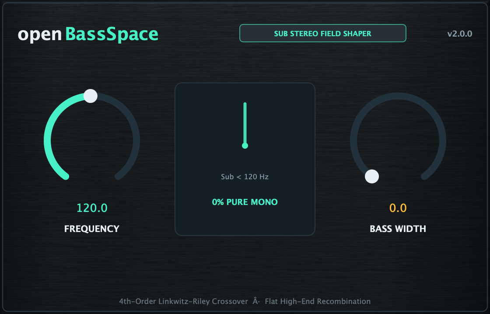

# openBassSpace

A precision low-frequency stereo field shaper and mono-maker plugin.

*Captured from the running VST3 editor.*

## Overview

`openBassSpace` gives you surgical control over the stereo width of your low-end:
- **Frequency**: 20 Hz to 500 Hz (4th-order Linkwitz-Riley crossover)
- **Bass Width**: 0% to 200%
  - **0%**: Collapses sub/low frequencies to pure mono for club punch and phase compatibility
  - **100%**: Completely transparent flat pass-through (no change)
  - **200%**: Wide stereo enhancement for spatial sub/bass FX

All frequencies above the crossover point are recombined with zero phase smearing and flat frequency response.

## Formats
- VST3
- Audio Unit (AU)
- Standalone
