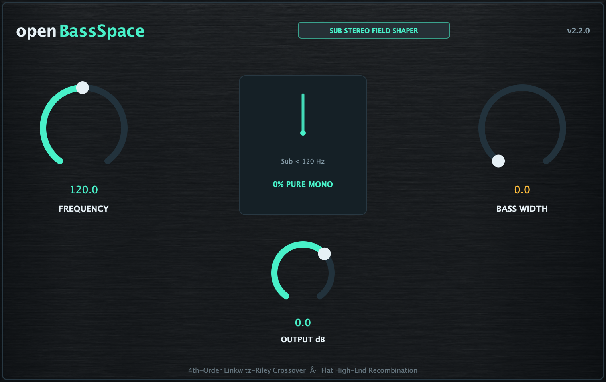

# openBassSpace

Set bass and upper-band stereo width independently. Keep bass centered or widen highs.

[Latest release](https://github.com/alanmarcero/openBassSpace/releases/latest) · [Install with OpenVST Manager](https://github.com/alanmarcero/alan-m-OpenVSTManager/releases/latest)

## Controls

- **Crossover:** 20–500 Hz.
- **Bass width:** 0% mono, 100% unchanged, 200% wider.
- **Upper width:** 0–200% above the crossover.
- **Stereoize:** Add width above crossover; bass stays centered (0–100%).
- The stereo-field rings pulse on each host quarter note, follow tempo changes and seeks, and freeze on stop. Standalone uses a 120 BPM sample clock. The two center lines show upper-band width.
- **Correlation meter:** −1 to +1.
- **Output trim:** −24 to +12 dB.

## Formats

VST3, Audio Unit (AU), standalone.

## License

MIT. [LICENSE](LICENSE).
