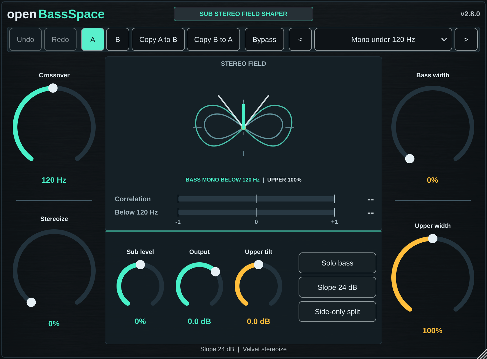

# openBassSpace

Set bass and upper-band stereo width independently. Keep bass centered or widen highs.

[Latest release](https://github.com/alanmarcero/openBassSpace/releases/latest) · [Install with OpenVST Manager](https://github.com/alanmarcero/alan-m-OpenVSTManager/releases/latest)

## Beta

All of these plugins are in beta. The macOS and Linux builds are not up to date, so the Windows build is the one to use for now. A plugin can change dramatically from one release to the next, but the goal is for each one to keep getting better.

## Controls

- **Crossover:** 20–500 Hz. Splits Width from the upper band.
- **Width:** Bass stereo width below the crossover. 0% mono, 100% unchanged, 200% wider.
- **Upper Width:** 0–200% above the crossover.
- **Stereoize:** Adds width above the crossover. Bass stays centered (0–100%).
- **Sub Drive:** Mono-locked harmonic saturation on the bass band (0–100%).
- **Upper Tilt:** Darkens or brightens the upper band, −6 dB to +6 dB.
- **Solo Bass:** Auditions only the band below the crossover.
- **Output:** Trim from −24 dB to +12 dB.
- **Bypass:** Host bypass. Audio crossfades back to the dry input, output trim included.
- **Correlation meter:** −1 to +1 for the full band and for the band below the crossover, smoothed over 300 ms. It reads `--` in silence and turns amber below 0.

The stereo-field rings pulse on each host quarter note, follow tempo changes and seeks, and freeze on stop. Standalone uses a 120 BPM sample clock. The long thin lines show upper-band width and the short thick lines show bass width. The caption under the field names both.

The editor is resizable from 720×520 with no locked aspect ratio. The window size is saved with the session.

## Presets

Factory programs, shown in the editor and the DAW program list:

- Mono under 120 Hz
- Mono under 80 Hz
- Mono under 200 Hz
- Flat
- Wide upper only
- Stereoize
- Solo bass
- Sub punch
- Air tilt

Factory presets are read-only. User presets save, rename, and delete under `~/Documents/Alan Marcero/openBassSpace/Presets`. The browser searches factory and user presets and stores favorites.

## Session tools

Undo and redo use the editor buttons or Cmd/Ctrl+Z and Shift+Cmd/Ctrl+Z (Ctrl+Y redoes). A slider drag, a typed value or a button click is one step. A and B keep two full states, each with its own undo history, so switching slots adds no step. Copying into a slot clears that slot's history.

## Formats

VST3, Audio Unit (AU), standalone.

## License

MIT. [LICENSE](LICENSE).
