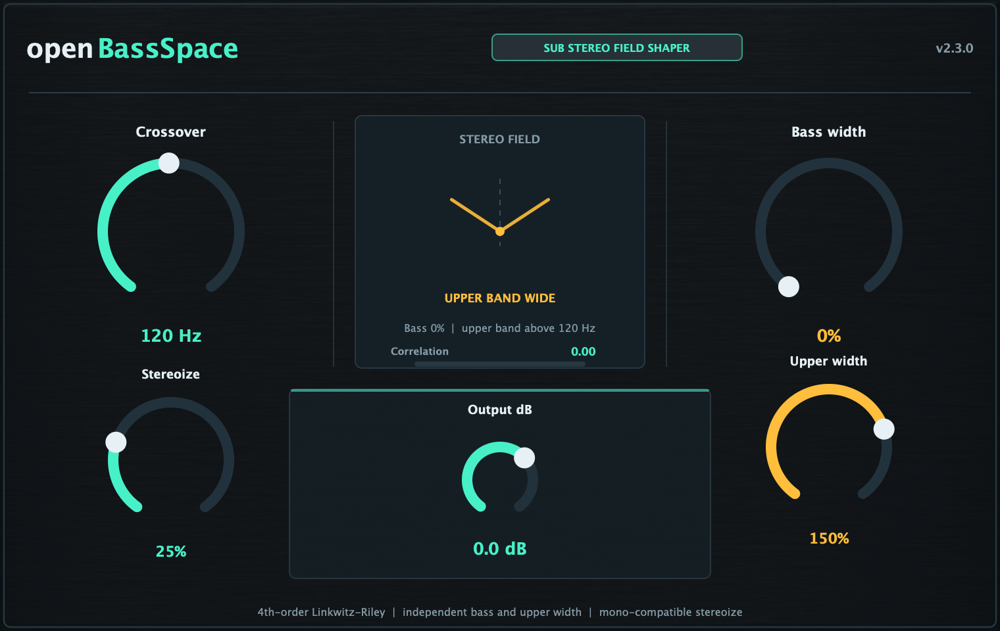

# Native UI screenshot

`assets/native-ui.png` is captured from the native `openBassSpace` 2.3.0 editor by the `native_editor` CTest. The test checks the parameter controls, output-level behavior, stereo width processing, mono-compatible Stereoize, correlation reporting, and editor labels before saving the screenshot at 2x scale.

The screenshot is refreshed from the local Release build for this feature branch. A release archive is not available yet.
